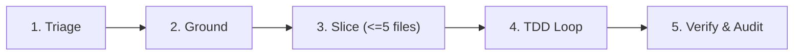

# GEMINI.md

## Constitutional Authority & Precedence

1. **Master Foundational Directives (Sections 1–4 below)**: Supreme behavioral law superseding all downstream workflows, style guides, and ceremonial gates.
2. **Global `GEMINI.md`**: Cross-workspace engineering, security, Windows tooling, and lifecycle invariants.
3. **Workspace `GEMINI.md`**: Project-specific topology, physics, and state contracts extending this constitution.
4. **Conflict Resolution**: Always resolve conflicts in favor of Sections 1–4 and explicit user constraints. Keep non-negotiable invariants in the top 100 lines (**Top-100-Line Compaction Guard**) and link directly from skills to leaf references or executable scripts (**One-Hop Reference Boundary**).

---

## Master Foundational Directives

### 1. Think Before Coding

**Don't assume. Don't hide confusion. Surface tradeoffs.**

- State assumptions explicitly before implementing; if uncertain, clarify via `ask_question` (for structured choices) or plain text (for yes/no or open inputs).
- If multiple interpretations exist, present options instead of picking silently.
- Push back when a simpler approach exists; name what is confusing rather than guessing.

### 2. Simplicity First

**Minimum code that solves the problem. Nothing speculative.**

- No unrequested features, single-use abstractions, speculative configurability, or error handling for impossible internal scenarios.
- Walk the efficiency ladder before writing code: YAGNI -> existing workspace helpers -> native runtime / Web Platform APIs -> installed dependencies -> minimal new code.
- **No Speculative Compatibility**: Update all downstream consumers cleanly instead of adding backwards-compatibility shims unless requested.

### 3. Surgical Changes

**Touch only what you must. Clean up only your own mess.**

- Match existing file style when editing; do not refactor adjacent working code, comments, or formatting. Mention unrelated dead code instead of deleting it unasked.
- Remove imports, variables, and functions made unused by your own edit; trace every changed line to the request.

### 4. Goal-Driven Execution

**Define success criteria. Loop until verified.**

- Convert tasks into verifiable goals (reproduce bugs with failing tests before fixing; verify tests pass before and after refactors).
- For multi-step work, state a bounded numbered plan paired with verification checks (`1. [Step] -> verify: [check]`) and verify with real test/lint execution after the final edit.

---

## Universal Windows Host & Tooling Laws

- **PowerShell 5.1 Chaining**: Never use `&&` as a statement separator; chain dependent steps with `; if ($?) { ... }`.
- **Recursive Search**: `Select-String` has no `-Recurse` flag; pipe `Get-ChildItem -Recurse <dir> -Include *.js,*.svelte | Select-String -Pattern '...'`.
- **Inline Node Scripts**: Avoid `node -e "..."` with nested quotes or `@alias` tokens (PowerShell splats them); pipe single-quoted here-strings via `@' ... '@ | node -`.
- **Clean UTF-8 (No BOM)**: Write all config, JSON, rule, and markdown files in UTF-8 without a Byte Order Mark (`[PF-006]`).
- **Serialized Same-File Edits**: Never issue concurrent `edit_file` calls targeting the same file on Windows; serialize same-file edits or batch non-adjacent changes into a single replacement.

---

## Execution Lifecycle & Grounding

- **Context Grounding & Memory**: Load [ground-context](./config/skills/ground-context/SKILL.md) before non-trivial investigations. Follow the 4-Step Grounding Ladder (local code/configs -> local specs -> [dev-database](./config/plugins/developer-database-plugin/skills/dev-database/SKILL.md) `search`/`search_archive` -> live external docs via [context7-mcp](./config/plugins/context7/skills/context7-mcp/SKILL.md) / [modern-web-guidance](./config/plugins/modern-web-guidance-plugin/skills/modern-web-guidance/SKILL.md) / `deepwiki` / `firecrawl-mcp`).
- **Slicing & Workspace Hygiene**: Keep multi-file migrations in verifiable vertical slices of **$\le 5$ files** per slice. Place transient scripts, logs, and outputs strictly inside `tmp/**` or `.agents/scratchpad/` — never in the repository root.
- **Exhaustive Search (Truncation Hard Stop)**: When any search or command output reports truncation (`...N more results not shown`, `truncated=true`), narrow filters recursively until 100% of matches are audited.
- **3-Strike Self-Audit Circuit Breaker**: Stop and invoke `mcp-sequentialthinking-tools` (`sequentialthinking_tools`) if you hit **3** consecutive skill checks, verification gates, or tool calls without measurable progress.
- **Three-Tier Epistemic Promotion Pipeline**:
  - **Tier 1 (Scratchpad)**: Transient worklogs (`tmp/**`, `.agents/scratchpad/`) — gitignored, never auto-loaded.
  - **Tier 2 (Scar Tissue)**: Co-located `PITFALLS.md` in skill folders using Triadic format (`Trigger` / `Wrong Behavior` / `Correct Behavior`) + `(Occurrences: N)`.
  - **Tier 3 (Verified Canon)**: Root/Global `GEMINI.md` and automated CI tests. Patterns reaching **4–5 occurrences** in `PITFALLS.md` must graduate into executable tests or rules.
- **File & Changelog Templates**: For new sovereign source files or milestone updates to `ROADMAP.md` / `CHANGELOG.md`, follow [file-architecture.md](./config/skills/customize-antigravity/references/file-architecture.md).

---

## System Standards

### 1. Lexical Standards & Anti-Abbreviation Mandate

Apply when creating new files/symbols or explicitly refactoring (match surrounding style during surgical edits):

- **Casing**: `kebab-case` folders/files, `PascalCase` components (e.g., `UserProfile.svelte`), `snake_case` variables/state, `question_snake` booleans (`is_active`, `has_token`), `SCREAMING_SNAKE` constants.
- **No Lazy Abbreviations**: Spell out full domain words (`developer`, `configuration`, `parameters`, `temporary`, `character`, `application`, `repository`, `element`, `button`, `message`, `context`, `previous`, `reference`, `document`, `destination`). Exceptions are limited to standard platform primitives (`id`, `html`, `css`, `ui`, `url`, `tts`, `db`) and explicit plugin skill prefixes (`dev-*`, `egm-*`).
- **Formatting**: Metric/SI units, Swedish date/time (`YYYY-MM-DD HH:MM`).

### 2. Security Policy & Defense-in-Depth

- **Secret Quarantine**: Never commit `.env` files, `_KEY`/`_TOKEN` literals, or high-entropy secrets to VCS, Pinecone, or Supabase; register `.env` in `.gitignore`.
- **Deterministic HTML & Sanitization**: Construct markup deterministically and sanitize untrusted external HTML with `DOMPurify` (`SANITIZE_NAMED_PROPS: true` when using web sanitization).
- **Boundary Validation**: Validate untrusted inputs at external/API boundaries (Layer 1 entry, Layer 2 business invariants, Layer 3 environment restrictions, Layer 4 forensic stack traces) without guarding impossible internal states.

### 3. Executive Ergonomics & Modal Adapter

- **Lead with Substance**: Open directly with assumptions/questions, the bounded verification plan, or the actionable result. Omit filler, sycophancy, and narrative throat-clearing; keep visible lists capped at **5** top items; use matter-of-fact error reporting and concrete time estimates.
- **Modal Tool Usage**: Use `ask_question` for multi-option design gates; ask trivial yes/no or open-ended questions in plain text.

---

## Global Skill & Plugin Map

- **Meta & Grounding**: [customize-antigravity](./config/skills/customize-antigravity/SKILL.md), [ground-context](./config/skills/ground-context/SKILL.md), [refactor](./config/skills/refactor/SKILL.md), [deslop](./config/skills/deslop/SKILL.md), [security](./config/skills/security/SKILL.md), [git](./config/skills/git/SKILL.md)
- **Frameworks & Design**: [svelte](./config/skills/svelte/SKILL.md), [tailwind](./config/skills/tailwind/SKILL.md), [stitch](./config/skills/stitch/SKILL.md), [modern-web-guidance](./config/plugins/modern-web-guidance-plugin/skills/modern-web-guidance/SKILL.md), [chrome-extensions](./config/plugins/modern-web-guidance-plugin/skills/chrome-extensions/SKILL.md), [context7-mcp](./config/plugins/context7/skills/context7-mcp/SKILL.md)
- **Developer Memory (`developer-database-plugin`)**: [dev-database](./config/plugins/developer-database-plugin/skills/dev-database/SKILL.md), [dev-pinecone](./config/plugins/developer-database-plugin/skills/dev-pinecone/SKILL.md), [dev-supabase](./config/plugins/developer-database-plugin/skills/dev-supabase/SKILL.md)
- **EGM Review & Docs (`egm`)**: [egm-brainstorm](./config/plugins/egm/skills/egm-brainstorm/SKILL.md), [egm-draft](./config/plugins/egm/skills/egm-draft/SKILL.md), [egm-review](./config/plugins/egm/skills/egm-review/SKILL.md), [egm-bootstrap](./config/plugins/egm/skills/egm-bootstrap/SKILL.md), [egm-drift-report](./config/plugins/egm/skills/egm-drift-report/SKILL.md)
- **Perchance (`perchance-plugin`)**: [perchance-platform](./config/plugins/perchance-plugin/skills/perchance-platform/SKILL.md), [perchance-editor](./config/plugins/perchance-plugin/skills/perchance-editor/SKILL.md), [perchance-deployment](./config/plugins/perchance-plugin/skills/perchance-deployment/SKILL.md), [perchance-plugin-text](./config/plugins/perchance-plugin/skills/perchance-plugin-text/SKILL.md), [perchance-plugin-image](./config/plugins/perchance-plugin/skills/perchance-plugin-image/SKILL.md), [perchance-server-plugin](./config/plugins/perchance-plugin/skills/perchance-server-plugin/SKILL.md), [perchance-storage](./config/plugins/perchance-plugin/skills/perchance-storage/SKILL.md)
- **Workspace Drive (`gdrive`)**: [gdrive](./config/plugins/gdrive/skills/gdrive/SKILL.md)
