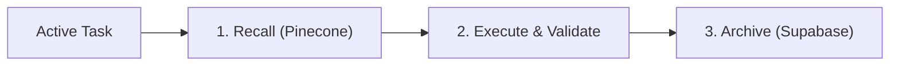

# Developer Database & Memory

The `developer-database` skill manages the dual-layer memory system: high-fidelity working memory for active development (Pinecone) and persistent cold storage for historical forensics (Supabase). This skill works in tandem with context brokers to ensure technical precision and architectural rationale are preserved across sessions.

---

## 1. Namespace Architecture

### `knowledge-base.external`

Technical specifications, framework logic, and community-proven patterns:

- **Svelte 5 Sovereignty**: Runes, State, and Migration standards.
- **Library Intelligence**: Bits UI, Dexie.js, Tailwind v4, and web platform standards.

### `knowledge-base.meta`

Agentic constitution, system blueprints, and behavioral directives:

- **Project Blueprint**: Macro-architectural mapping across Core, UI, Data, and Intelligence layers.
- **Behavioral Standards**: Prompting contracts, security invariants, and trace guidelines.

---

## 2. Operational Workflow



1. **Recall**: Query working memory (`knowledge-base.meta` or `knowledge-base.external`) before proposing architectural shifts or refactors.
2. **Historical Search**: Query cold storage via `session_id` or `task_slug` to reconstruct past decision narratives and post-mortems.
3. **Inscription**: Ingest new patterns once verified and finalized in code.
4. **Archival**: Persist mission summaries, architectural blueprints, and decisions to cold storage upon task completion.

---

## 3. Tool Usage Examples

```bash
# Search technical knowledge base for active patterns
call_mcp_tool ServerName: "developer-database" ToolName: "read_knowledge_base" Arguments: { "query": "Svelte 5 Runes patterns" }

# Describe index status and namespace metadata
call_mcp_tool ServerName: "developer-database" ToolName: "describe_knowledge_base" Arguments: {}

# Inscribe a verified architectural pattern
call_mcp_tool ServerName: "developer-database" ToolName: "write_knowledge_base" Arguments: { "namespace": "knowledge-base.meta", "title": "4-Quadrant State Architecture", "content": "..." }

# Archive a completed mission summary to cold storage
call_mcp_tool ServerName: "developer-database" ToolName: "archive_log_entry" Arguments: { "task_slug": "audio-standardization", "content": "Mission complete: standardized Web Audio registry and lifecycle hooks" }

# Query cold storage decision history
call_mcp_tool ServerName: "developer-database" ToolName: "query_cold_storage" Arguments: { "task_slug": "audio-standardization" }
```

---

## 4. Troubleshooting & Best Practices

| Issue                 | Resolution                                                                                             |
| :-------------------- | :----------------------------------------------------------------------------------------------------- |
| **No Results Found**  | Broaden search terms or run `describe_knowledge_base` to verify index health and available namespaces. |
| **Duplicate Records** | Use specific `task_slug` or semantic keywords to isolate historical records.                           |
| **Ambiguous Context** | Quote exact retrieval snippets in the plan/decision log to ground implementation choices.              |

---

## 5. Verification Checklist

- [ ] `read_knowledge_base` queried prior to structural architectural decisions.
- [ ] Task summary and key decisions archived to cold storage via `archive_log_entry`.
- [ ] Ingested content confirmed free of API keys, `.env` variables, or secrets.
- [ ] Evidence quoted directly from memory to justify architectural approaches.
