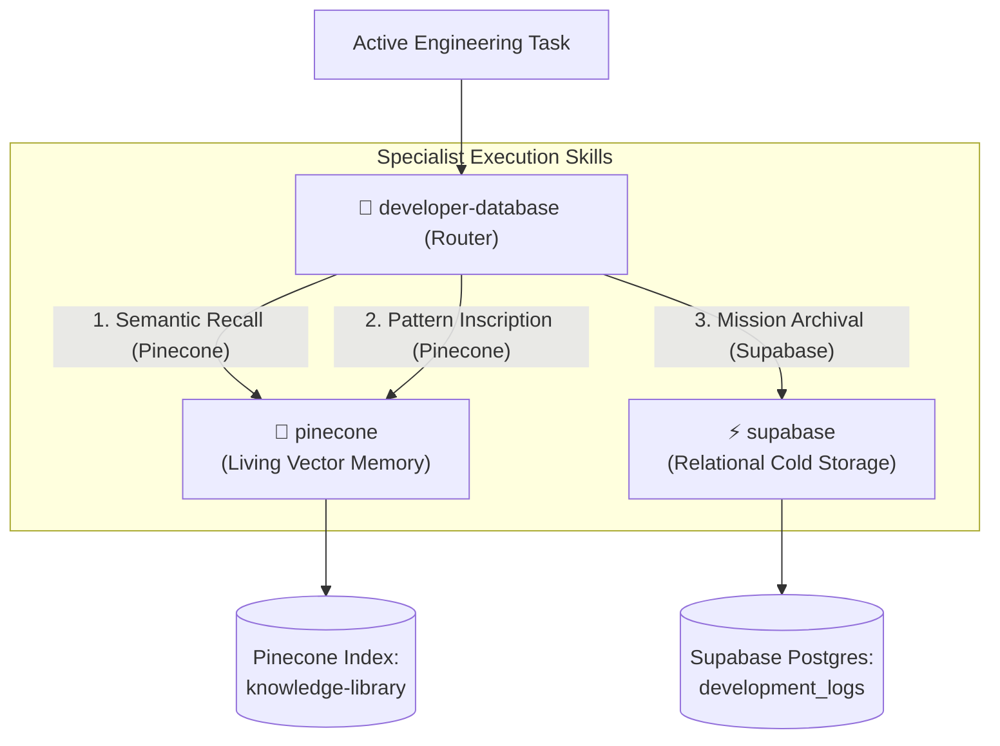

# Developer Database & Memory Orchestrator

> **Persona: The Memory Conductor & Dual-Layer Router**  
> _"I orchestrate the dual-layer memory lifecycle: grounding active development through Living Vector Memory and anchoring completed architectural missions into Relational Cold Storage."_

---

## 1. System Topology & Dual-Layer Architecture

The `developer-database` skill acts as the **central router and conductor** for agentic memory. It coordinates two specialized memory engines:

- **Living Vector Memory ([`pinecone`](../pinecone/SKILL.md))**:
  - High-fidelity working memory for active development.
  - Svelte 5 patterns, library contracts, and active project rules.
  - Rapid semantic retrieval via `read_knowledge_base`.
- **Relational Cold Storage ([`supabase`](../supabase/SKILL.md))**:
  - Persistent relational history for completed missions and retrospectives.
  - Searchable by `task_slug`, `session_id`, or timestamp via `query_cold_storage`.
  - Durable trace persistence via `archive_log_entry`.

---

## 2. Operational Lifecycle

1. **Step 1: Grounding & Recall (Start of Task)**:
   - Query living memory via `read_knowledge_base` to retrieve verified framework logic, architectural standards, or prior design patterns.
   - For historical decision forensics, query cold storage via `query_cold_storage`.
2. **Step 2: Execution & Inscription (During Task)**:
   - Validate implementation code against ground truth.
   - Ingest verified, stable architectural patterns into living memory via `write_knowledge_base`.
3. **Step 3: Archival (Completion of Task)**:
   - Persist mission summary, trade-offs, and forensic verification traces to cold storage via `archive_log_entry`.
   - Ensures continuous historical record across multi-session trajectories.

---

## 3. Tool Routing Table

| Operational Need                      | Primary Tool              | Delegated Specialist Skill                       |
| :------------------------------------ | :------------------------ | :----------------------------------------------- |
| **Search active knowledge base**      | `read_knowledge_base`     | [skills/pinecone/SKILL.md](../pinecone/SKILL.md) |
| **Inspect index status & namespaces** | `describe_knowledge_base` | [skills/pinecone/SKILL.md](../pinecone/SKILL.md) |
| **Ingest & embed codebase rules**     | `write_knowledge_base`    | [skills/pinecone/SKILL.md](../pinecone/SKILL.md) |
| **Archive mission post-mortem**       | `archive_log_entry`       | [skills/supabase/SKILL.md](../supabase/SKILL.md) |
| **Query historical decision logs**    | `query_cold_storage`      | [skills/supabase/SKILL.md](../supabase/SKILL.md) |

---

## 4. Specialist Skill Delegation

When deeper technical specialization is required:

- For vector math, integrated `/embed` models, namespace partitioning, or MongoDB-style metadata filters:
  $\rightarrow$ Delegate to **[`skills/pinecone/SKILL.md`](../pinecone/SKILL.md)**
- For PostgreSQL schemas, table migrations, connection pooling, and Row-Level Security (RLS) rules:
  $\rightarrow$ Delegate to **[`skills/supabase/SKILL.md`](../supabase/SKILL.md)**

---

## 5. Verification Checklist

- [ ] Working memory (`read_knowledge_base`) queried prior to proposing structural refactors.
- [ ] Ingested content confirmed free of `.env` secrets, credentials, or transient scratchpad data.
- [ ] Task summary, architectural choices, and verification results archived via `archive_log_entry`.
- [ ] Keepalive heartbeat verified across both Pinecone and Supabase layers.
