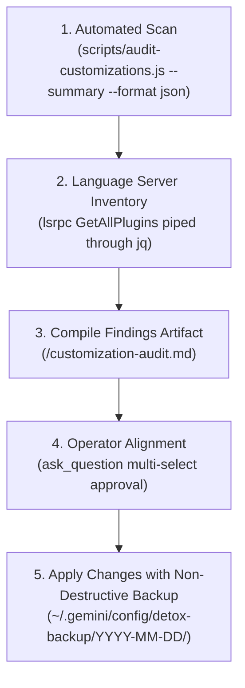

# Customization Audit & Setup Detox Playbook (`audit-and-detox.md`)

> **Authority: Tier 3 Reference Guide**  
> *"Audit across all five customization layers. Quantify token bloat, catch contradictory rules, eliminate drift, and always require operator confirmation with non-destructive backup before applying changes."*

---

## 1. Overview & Operating Philosophy

As customizations grow across global (`~/.gemini/config/`), workspace (`.agents/`), and installed plugins, systems accumulate:
* Duplicated or contradictory rules between `GEMINI.md`, `AGENTS.md`, and plugin manifests.
* Broken relative links and multi-hop reference chains (`[PF-004]`).
* Illegal or non-standard YAML frontmatter fields (`[PF-008]`).
* Windows UTF-8 Byte Order Marks (BOM) crashing language server parsers (`[PF-006]`).
* Unused, high-token MCP server definitions or dead sidecar processes.

The **Customization Detox Protocol** evaluates your entire Antigravity setup across five distinct layers, calculates exact description token costs, surfaces findings in a structured audit artifact, and safely archives pruned components into `~/.gemini/config/detox-backup/YYYY-MM-DD/`.

---

## 2. The 5-Layer Audit Matrix

| Layer | Targets | Audit Checks | Remediation Actions |
| :--- | :--- | :--- | :--- |
| **Layer 1: Rules** | `GEMINI.md`, `AGENTS.md`, `plugins/*/rules/AGENTS.md` | • Contradictory rules between global & workspace<br>• Duplicated rules across levels<br>• Broken relative markdown links<br>• Stray rule files (`[PF-005]`, `[PF-007]`) | `edit_file` (deduplicate / clarify), `archive_rule` |
| **Layer 2: Skills** | `skills/*/SKILL.md`, `.agents/skills/*/SKILL.md` | • Strict 2-field frontmatter check (`[PF-008]`)<br>• Trigger Triad presence (`[PF-001]`, `[PF-003]`)<br>• Co-located `PITFALLS.md` existence & line-1 link<br>• One-hop reference depth (`[PF-004]`)<br>• UTF-8 BOM bytes (`[PF-006]`)<br>• Top 10 skills by description tokens | `edit_file` (format triad), `backup_skill` (move to backup), `scaffold_pitfalls` |
| **Layer 3: Plugins & MCPs** | `lsrpc GetAllPlugins`, `mcp_config.json`, `list_plugin_accounts` | • Disconnected auth accounts<br>• Duplicate MCP servers or services<br>• Legacy SSE endpoints needing `mcp-remote`<br>• Missing `variables` declarations for `${X}`<br>• Non-standard `plugin.json` keys | `reconnect_account`, `backup_plugin`, `edit_mcp_config` |
| **Layer 4: Hooks & Sidecars** | `hooks.json`, `sidecars/*/sidecar.json` | • Non-existent script paths or missing executables<br>• Missing timeouts in hook commands<br>• Stale or disabled scheduled sidecars | `edit_file`, `backup_sidecar` |
| **Layer 5: Epistemic Graduation** | `PITFALLS.md`, `MISTAKES.md` | • Scan entries with `Occurrences >= 4`<br>• Verify graduation into CI tests or `GEMINI.md` | `graduate_to_ci`, `graduate_to_gemini` |

---

## 3. Step-by-Step Execution Workflow



### Step 1: Run the Deterministic Scanner

Execute the co-located Node.js audit script in discovery mode:

```bash
node ~/.gemini/config/skills/agent-customization/scripts/audit-customizations.js --workspace "<path-to-workspace>" --summary --format json
```

For detailed findings on a specific item:
```bash
node ~/.gemini/config/skills/agent-customization/scripts/audit-customizations.js --check <finding-id>
```

### Step 2: Query Installed Plugins

Talk to the Language Server Connect RPC using the safe piped recipe:

```bash
source /tmp/lsrpc.sh && lsrpc GetAllPlugins '{"workspaceUris":["file:///path/to/workspace"]}' | jq '[.plugins[] | {
  name,
  dir: (.path | split("/") | last),
  disabled: (.disabled // false),
  isGlobal,
  skills: [.skills[]?.name],
  mcp: [.mcpServers[]?.name]
}]'
```

### Step 3: Present Audit Artifact

Create `<brain>/customization-audit.md` with `RequestFeedback: true` detailing:
1. **Summary Statistics**: Total skills, total MCP servers, total rules files, and total estimated description tokens.
2. **P0/P1 Violations**: UTF-8 BOMs, illegal frontmatter properties (`[PF-008]`), and broken one-hop links.
3. **Bloat & Over-Triggering Risks**: Skills exceeding 500 characters in description without negative boundaries (`Do NOT use for...`).
4. **Graduation Alerts**: Tier 2 `PITFALLS.md` items with $\ge 4$ occurrences eligible for CI test graduation.

### Step 4: Operator Approval Gate

Invoke `ask_question` presenting actionable checkboxes. **Never delete or mutate customizations without explicit operator approval.**

### Step 5: Safe Non-Destructive Backup

When pruning or decommissioning a skill, plugin, or sidecar, move its directory to the dated backup folder rather than deleting:

```text
~/.gemini/config/detox-backup/YYYY-MM-DD/
├── skills/
│   └── <pruned-skill>/
└── plugins/
    └── <pruned-plugin>/
```
