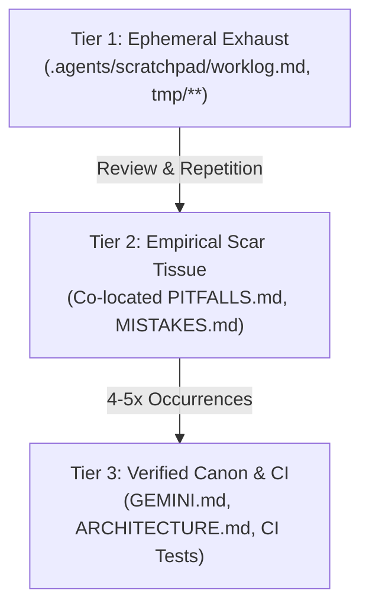

# Epistemic Architecture & Markdown Exhaust Management

> **Authority: Tier 3 Reference Guide**  
> *"A rule can be ignored; a red test cannot. Never pollute canonical specs with ephemeral agent diaries."*

---

## 1. The Three-Tier Epistemic Promotion Pipeline

Autonomous agents generate significant textual exhaust during planning, tool execution, and error recovery. In unconstrained repositories, agents write exploratory notes, temporary bug hypotheses, and inconsistent guidelines directly into persistent rulebooks (`GEMINI.md`, `AGENTS.md`). Over time, this causes **context poisoning**, rule drift, and severe token bloat.

To prevent canon degradation, all Antigravity workspaces enforce the **Three-Tier Epistemic Promotion Pipeline**:



---

## 2. Epistemic Tier Specifications

### Tier 1: Ephemeral Exhaust & Mutable Scratchpad

* **Location**: `.agents/scratchpad/worklog.md`, `.agents/scratchpad/compact-state.json`, `tmp/**`.
* **Access Authority**: Worker agent sessions have append-only write authority.
* **Retrieval Mode**: Never indexed at session initialization; gitignored.
* **Format**:

  ```markdown
  - [2026-10-19T22:30Z] [worker-session] Pitfall candidate: Express middleware mutated req.body before signature verification.
  ```

* **Lifecycle**: Ephemeral. Pruned or cleared upon session handoff or task completion.

### Tier 2: Empirical Scar Tissue & Failure Parables

* **Location**: Skill-local `skills/<name>/PITFALLS.md` and repository-level `MISTAKES.md`.
* **Access Authority**: Read-only during execution; updated during session `/wrap-up`, human corrections, or by specialized curator skills.
* **Retrieval Mode**: Referenced at **line 1** of `SKILL.md` or root prompt so the agent reviews known failure traps immediately before modifying code.
* **Format**: Must follow the **Triadic Entry Format** (Trigger, Wrong Behavior, Correct Behavior).

### Tier 3: Verified Canon & Executable CI Gates

* **Location**: `GEMINI.md`, `ARCHITECTURE.md`, `DESIGN.md`, and automated test scripts (`npm test`, `scripts/ci_hygiene.js`).
* **Access Authority**: Immutable to worker sessions. Only updated through verified architectural consensus and pull requests.
* **The CI Graduation Rule**: When an empirical failure pattern in Tier 2 reaches **4 to 5 occurrences**, prose guidelines have reached diminishing returns. It **must graduate** out of Markdown and into an executable CI test or automated lint rule.

---

## 3. The Triadic Failure Parable Format

Every entry in `PITFALLS.md` or `MISTAKES.md` must be structured into three explicit components:

1. **Trigger (Silent Killer Context)**: The exact deceptive condition or code context where the pitfall lurks.
2. **Wrong Behavior (Root Cause & Anti-Pattern)**: A concrete explanation of why naive heuristics fail, accompanied by a `// Bad` snippet.
3. **Correct Behavior (Non-Negotiable Solution)**: The required idiom, accompanied by a copy-pasteable `// Good` snippet.

### Example Template

````markdown
### [PF-042] Unsanitized Dynamic HTML in Svelte Runes (Occurrences: 4 — GRADUATED TO CI)

- **Trigger**: Rendering user-provided markdown or rich text strings inside Svelte components.
- **Wrong Behavior (Root Cause)**: Injecting unsanitized HTML via `{@html raw_content}`.
  ```svelte
  <!-- Bad: Direct XSS vulnerability -->
  <div class="prose">{@html user_input}</div>
  ```

* **Correct Behavior (Prevention Rule)**: Always pipe untrusted HTML through `DOMPurify.sanitize()` before passing to `{@html}`.

  ```svelte
  <!-- Good: Sanitized prior to template evaluation -->
  <div class="prose">{@html DOMPurify.sanitize(user_input)}</div>
  ```

````

---

## 4. The Locality Fix: Eliminating Rule Blindness

**Central Board Rule Blindness** occurs when engineering teams place all rules, gotchas, and pitfalls in a single massive central file at the repository root. When an agent is directed to edit an isolated file (`src/engine/physics.js`), it has no reason to load or search the distant central log.

**The Locality Fix** solves this by:

1. Co-locating `PITFALLS.md` directly inside the domain skill directory (`skills/physics-engine/PITFALLS.md`).
2. Referencing `PITFALLS.md` at line 1 of `SKILL.md`:

   ```markdown
   ## 1. Mandatory Pre-Flight & Pitfalls Check
   Before editing code, read `PITFALLS.md` in this directory to review domain-specific traps.
   ```

This guarantees the guardrail is loaded into context at the exact moment of work.
