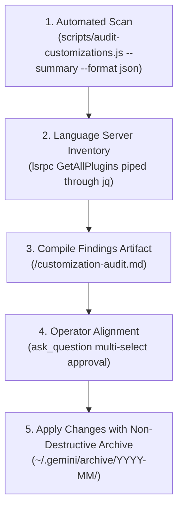

# Customization Audit & Setup Detox Playbook (`audit-and-detox.md`)

> **Authority: Tier 3 Reference Guide**
> Audit across all five customization layers. Quantify token bloat, catch contradictory rules, eliminate drift, and require operator confirmation with non-destructive archival before removing components.

---

## 1. Overview & Operating Philosophy

As customizations grow across global (`~/.gemini/config/`), workspace (`.agents/`), and installed plugins, setups accumulate:

* Duplicated or contradictory rules across `GEMINI.md`, `AGENTS.md`, and built-in skills.
* Broken relative links and multi-hop reference chains (`[PF-004]`).
* Non-standard YAML frontmatter fields (`[PF-008]`) or incomplete Trigger Triads (`[PF-003]`).
* Windows UTF-8 Byte Order Marks (BOM) crashing language server parsers (`[PF-006]`).
* Unused MCP server definitions, dead sidecar processes, or stale workspace leaks in global skills.

The **Customization Detox Protocol** evaluates the Antigravity setup across all five layers, calculates token costs, surfaces findings in an audit report, and archives pruned components into `~/.gemini/archive/YYYY-MM/`.

---

## 2. The 5-Layer Audit Matrix

| Layer | Targets | Audit Checks | Remediation Actions |
| :--- | :--- | :--- | :--- |
| **Layer 1: Rules** | `~/.gemini/GEMINI.md`, `<workspace>/GEMINI.md`, `plugins/*/rules/AGENTS.md` | • File size under `24,000` bytes (prevents silent truncation)<br>• Global vs. workspace boundary separation<br>• Broken relative markdown links<br>• Stray rule files (`[PF-005]`, `[PF-007]`) | `edit_file` (deduplicate / clarify), `archive_rule` |
| **Layer 2: Skills** | `~/.gemini/config/skills/*/SKILL.md`, `.agents/skills/*/SKILL.md` | • Strict 2-field frontmatter check (`[PF-008]`)<br>• Trigger Triad presence (`[PF-001]`, `[PF-003]`)<br>• Co-located `PITFALLS.md` existence & top-section link<br>• One-hop reference depth (`[PF-004]`)<br>• UTF-8 BOM bytes (`[PF-006]`) | `edit_file` (format triad), archive to `~/.gemini/archive/YYYY-MM/`, `scaffold_pitfalls` |
| **Layer 3: Plugins & MCPs** | `lsrpc GetAllPlugins`, `mcp_config.json`, `list_plugin_accounts` | • Disconnected auth accounts<br>• Duplicate MCP servers or services<br>• Legacy SSE endpoints needing `mcp-remote`<br>• Missing `variables` declarations for `${X}`<br>• Non-standard `mcp_config.json` / `plugin.json` keys | `reconnect_account`, archive plugin, `edit_mcp_config` |
| **Layer 4: Hooks & Sidecars** | `hooks.json`, `sidecars/*/sidecar.json` | • Non-existent script paths or missing executables<br>• Missing timeouts in hook commands<br>• Stale or disabled scheduled sidecars | `edit_file`, archive sidecar |
| **Layer 5: Epistemic Graduation** | `PITFALLS.md`, `MISTAKES.md` | • Scan entries with `Occurrences >= 4`<br>• Verify graduation into CI tests or constitutional rules | `graduate_to_ci`, `graduate_to_gemini` |

---

## 3. Step-by-Step Execution Workflow



### Step 1: Run the Deterministic Scanner

Execute the co-located Node.js audit script in discovery mode:

```bash
node ~/.gemini/config/skills/customize-antigravity/scripts/audit-customizations.js --workspace "<path-to-workspace>" --summary --format json
```

For detailed findings on a specific item:

```bash
node ~/.gemini/config/skills/customize-antigravity/scripts/audit-customizations.js --check <finding-id>
```

### Step 2: Query Installed Plugins

Talk to the Language Server Connect RPC using the safe piped recipe:

```bash
source /tmp/lsrpc.sh && lsrpc GetAllPlugins '{"workspaceUris":["file:///path/to/workspace"]}' | jq '[.plugins[] | {
  name,
  dir: (.path | split("/") | last),
  disabled: (.disabled // false),
  isGlobal,
  skills: [.skills[]?.name],
  mcp: [.mcpServers[]?.name]
}]'
```

### Step 3: Present Audit Artifact

Create `<brain>/customization-audit.md` with `RequestFeedback: true` detailing:

1. **Summary Statistics**: Total rules, skills, subagents, MCP servers, and estimated token budgets.
2. **P0/P1 Violations**: UTF-8 BOMs, illegal frontmatter properties (`[PF-008]`), and broken one-hop links.
3. **Bloat & Over-Triggering Risks**: Descriptions exceeding token targets or missing Trigger Triad boundaries (`Do NOT use for...`).
4. **Graduation Alerts**: Tier 2 `PITFALLS.md` items with `>= 4` occurrences eligible for CI test graduation.

### Step 4: Operator Approval Gate

Invoke `ask_question` presenting actionable options. Never delete or move customizations without explicit operator approval.

### Step 5: Safe Non-Destructive Archive

When retiring a skill, plugin, or reference leaf, move its directory to the dated archive folder rather than deleting:

```text
~/.gemini/archive/YYYY-MM/
├── skills/
│   └── <pruned-skill>/
└── <pruned-refs>/
```
