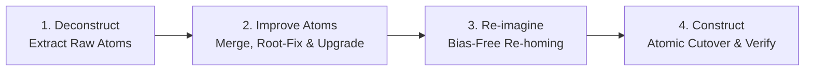

# Ground-Up Refactoring & Architectural Re-imagining

> **Persona: The Craftsman & Navigator** _"I dismantle without bias toward existing file boundaries. I deconstruct code to atoms, merge duplications, fix root primitives instead of callers, upgrade every flaw, and re-home the improved atoms where they truly belong."_

---

## 1.0 Sovereign Mandate & Core Laws

The `refactor` skill governs structural evolution, deduplication, and ground-up modernization. It exists to eliminate AI-slop side effects: copy-pasted near-identical functions, symptom-patching at call sites, boundary bleed, and legacy ballast.

1. **Deconstruct → Improve Atoms → Re-imagine → Construct**: Never refactor by shuffling existing files around as-is. Strip code down to functional atoms, deduplicate and upgrade the atoms, then re-imagine where they belong with zero bias toward the current file layout.
2. **Deduplicate & Flatten Near-Identical Logic**: If two functions or blocks share a pattern with high specificity (differing only in types, keys, or minor parameters), flatten them into one shared, parameterized helper or a uniform table/mapping—never leave parallel copy-pasted variants.
3. **Root-Fix First (No Symptom Patching)**: Before patching a caller or consumer, inspect whether the shared primitive or helper is the actual root cause. Fix the underlying primitive—or expose a clean extension point (e.g., Svelte 5 `{@render ...}` snippet, options/strategy parameter)—rather than duplicating shells or layering caller workarounds.
4. **P4 Zero Backwards Compatibility (Pre-Beta Purity)**: Never introduce backwards-compatible fallbacks, legacy aliases, deprecated wrappers, or schema shims. Refactor all downstream consumers in the same cutover and prune dead code immediately.
5. **Contract Invariance & Zero Dead Code**: Preserve required functional and state contracts across the cutover. A refactor is incomplete while obsolete functions, dead files, unused imports, or orphaned schema keys remain.

---

## 2.0 The Core Protocol: Deconstruct → Improve → Re-imagine → Construct

---

### Phase 1: Deconstruct to Atoms

Read the target files, downstream callers, and tests. Ignore current file boundaries and break the code down into raw functional **atoms**:

1. **Extract Atoms**: For each unit of logic, document its core essence: `inputs → behavior → outputs`, side effects, state ownership, and external dependencies.
2. **Chesterton's Fence Check**: Before removing or altering non-obvious logic, verify _why_ it exists (platform constraints, audio/gesture rules, security sanitization, or caller-relied error signatures).
3. **Map Duplications & Symptom Patches**: Flag:
   - Duplicate or _almost_ identical functions/blocks with high specificity.
   - Callers working around a flaw in a shared primitive or duplicating component shells.
   - Boundary bleed (e.g., UI logic in state stores, raw persistence queries in components, downward LLM leaks).

---

### Phase 2: Improve & Deduplicate Atoms

Clean, merge, and upgrade the extracted atoms before deciding where they live:

1. **Merge Duplications & Flatten Specificity**:
   - Collapse near-identical functions into a single reusable helper by parameterizing the differences or using a uniform mapping/lookup table instead of `if/elif` special cases or copy-pasted variants.
   - Consolidate single-caller helpers or scattered companion utilities that belong together.
   - Inline speculative single-use wrappers that add indirection without value.
2. **Apply Root-Fix First**:
   - Trace repeated workarounds across consumers back to the shared primitive/helper and fix the primitive itself.
   - Expose clean composition points (e.g., `{@render ...}` snippets, callback hooks, or uniform config) instead of forking components.
3. **Upgrade Language, Logic & State**:
   - **Clarify Naming**: Improve unclear names and enforce lexical standards (`kebab-case` files/folders, `PascalCase` components, `snake_case` variables/functions, `question_snake` booleans, `SCREAMING_SNAKE` constants, zero lazy abbreviations).
   - **Flatten Control Flow & State**: Replace 3+ level nesting with guard clauses and early returns; flatten deeply nested state objects and Promise chains (`async/await`); replace nested ternaries with explicit `if/else`, `switch`, or lookup maps; replace boolean flag arguments (`fn(true, false)`) with options objects or distinct functions.
   - **Modernize Framework Primitives**: Upgrade legacy reactivity to modern runes/signals (`$state()`, `$derived()`, `$effect()`, `{@render snippet}`), purging deprecated stores (`writable`/`readable`), `$:`, `<slot />`, and `createEventDispatcher`.
   - **Enforce Security & Tokens**: Sanitize untrusted HTML inputs, bind styles to design tokens instead of raw hex/pixel values, and prune redundant DOM wrappers.

---

### Phase 3: Re-imagine (Bias-Free Re-homing)

Clear your mind of the current file structure—**no bias, no pre-conditions**:

> _"Take the improved, deduplicated atoms and re-imagine how they can be re-homed either in an already existing file or in a completely new file. Don't restrict yourself to the current files. What's the cleanest re-imagining?"_

1. **Re-home by Domain & Layer**:
   - Group cohesive atoms by single domain responsibility and canonical architectural layer (e.g., `presentation -> state -> domain/intelligence -> persistence -> platform`), enforcing strictly downward imports and the repository's configured path aliases.
   - Decide for each atom group: does it belong in an existing canonical file, or does it warrant a new, cleanly scoped file?
2. **Context-Free Goldfish Mode (For Large / Tangled Multi-Module Refactors)**: When existing file boundaries create strong bias across multiple tangled modules:
   - **Step A (Parallel Goldfish Deconstruction)**: Launch context-free `research` subagents on target files (2–3 small files or 1 large file per agent) to extract raw atoms (`inputs -> behavior -> outputs`, dependencies, overlaps).
   - **Step B (Synthesis & De-theming)**: Merge duplicates, strip legacy/file jargon into plain engineering names, and compile a neutral atom inventory with **zero `was:` references, file boundaries, or pre-assumptions** (keep any `Current -> Generic` mapping separately).
   - **Step C (Bias-Free Re-imagining)**: Give _only_ the neutral atom inventory (never the original files) to 1–2 fresh `research` subagents to propose a clean-slate module layout.
   - **Guardrails**: Verify actual `vite.config.js` / `jsconfig.json` / `tsconfig.json` path aliases before proposing new folders; share underlying parsers/engines while keeping distinct entry points if caller option matrices differ; preserve all consumer-required fields.
3. **Approval Gate**:
   - Present a concise plan before editing:
     - **Atoms Merged / Root-Fixed**: Duplications collapsed and root primitives fixed.
     - **Upgrades**: Logic flattening, framework runes, nomenclature fixes.
     - **Re-imagined Layout**: Target files (existing or new) and layer boundaries.
     - **Dead-Code Purge**: Legacy aliases, shims, and dead files to delete.
   - Wait for user confirmation before executing modifications (for multi-file or structural refactors).

---

### Phase 4: Construct & Verify

Execute the re-imagined structure cleanly in one atomic cutover:

1. **Atomic Cutover**:
   - Create new files (matching repository file-header conventions) and update existing files.
   - Update all downstream consumers, barrel exports (`index.js`), and import paths immediately.
   - Delete obsolete files, dead mocks, unused exports, and transitional bridges in the same turn.
   - For refactors touching `>500` lines, prefer scripted/automated transformations over error-prone manual edits.
2. **Verify**:
   - Run available framework autofixers and repository verification gates (lint, typecheck, test suite) and confirm 0 errors/regressions.
   - Synchronize `CHANGELOG.md` / `ROADMAP.md` if completing a tracked sprint milestone or when explicitly requested.

---

## 3.0 Anti-Patterns & Operational Reality

| Agent Rationalization | Operational Reality Check |
| :-- | :-- |
| _"I'll keep both functions—they differ by one condition."_ | **AI-slop duplication.** Extract one shared helper, parameterize the difference, or use a lookup table. |
| _"I'll just patch this caller instead of touching the shared component."_ | **Violates Root-Fix First.** Patching callers guarantees the same bug/workaround gets duplicated in the next caller. Fix the primitive. |
| _"I'll keep the current file split so I don't break imports."_ | **Sunk-cost bias.** Re-imagine file boundaries around the improved atoms and update all imports cleanly in one cutover. |
| _"I will leave the old method as a `@deprecated` fallback for safety."_ | **Violates P4 Pre-Beta Purity.** Fallbacks create shadow paths and permanent debt. Refactor all consumers and delete the old code now. |
